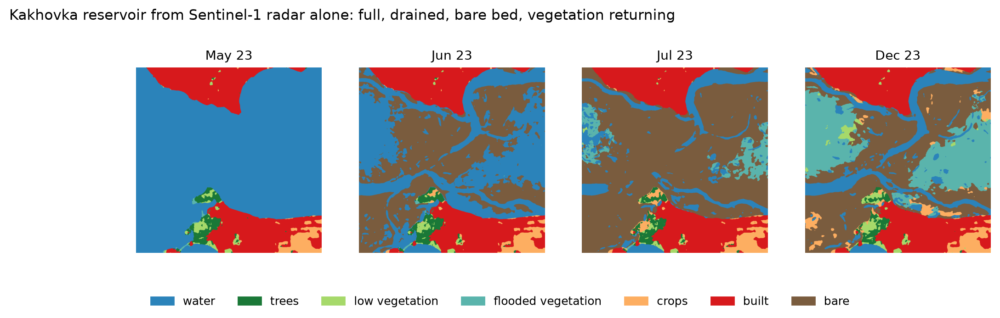

# Monthly Land Cover from Sentinel-1 Radar

   

Give it a point on Earth and a start month. It returns twelve monthly land-cover maps of the 10 km square around that
point, the share of each class in every month, and what changed between months. The only input is Sentinel-1 radar,
which sees through cloud, so rainy seasons and flood months do not leave gaps the way optical imagery does.

Course project for **Deep Learning** (November 2026): a semantic segmentation model plus a working prototype.

| | |
|---|---|
| **Dataset** | [huggingface.co/datasets/YashAnnapure/sentinel1-lulc-dataset](https://huggingface.co/datasets/YashAnnapure/sentinel1-lulc-dataset) |
| **Model weights** | [huggingface.co/YashAnnapure/sentinel1-lulc-unet](https://huggingface.co/YashAnnapure/sentinel1-lulc-unet) |
| **Training code** | [`notebooks/02_train.ipynb`](notebooks/02_train.ipynb), [`run_experiments.py`](run_experiments.py), [`lulc.py`](lulc.py) |
| **Prototype code** | [`app.py`](app.py), [`prototype.py`](prototype.py) |
| **Report** | [`docs/report.docx`](docs/report.docx) |



## Results at a glance

The final model was scored **once**, on 14 holdout sites it never saw (6 tropical, 8 in Europe and the Americas).
Scores are IoU against Dynamic World, the optical land-cover map the model learned from.

| Model | Training sites | mIoU | Tropics | New regions |
|---|---|---|---|---|
| First prototype model (ResNet-34, seed 0) | 29 | 0.433 | 0.357 | 0.437 |
| ResNet-50 from scratch | 29 | 0.423 | 0.366 | 0.414 |
| ResNet-50, SSL4EO pretraining | 29 | 0.414 | 0.338 | 0.423 |
| **Final model** (ResNet-50 from scratch) | **103** | **0.481** | 0.366 | **0.493** |

| Class | built | water | trees | low vegetation | crops | bare | flooded vegetation |
|---|---|---|---|---|---|---|---|
| IoU (final model) | 0.807 | 0.790 | 0.633 | 0.422 | 0.409 | 0.238 | 0.070 |

- **Change detection.** In the stress test the maps catch the draining of the Kakhovka reservoir (water 76% → 12% of
  the square in two months), the return of Tulare Lake in 2023 and the 2022 Manchar Lake flood, each in the right
  month. The 2025 Palisades fire was missed.
- **Fewer false changes.** Averaging two seeds and a three-month window cuts pixels that flip class while Dynamic World
  stays the same from 8.8% to 3.6%, at the cost of missing short, one-month changes.
- **Where it works.** Nine of ten ordinary landscapes agree with Dynamic World on 81% to 100%, including Furano in
  Japan, 1,512 km from the nearest training site.
- **Where it fails.** Snow, ice and steep mountains (no class for them), the dry Australian outback, and the two weak
  classes above: flooded vegetation and bare ground.

Every number traces to a file in [`experiments/`](experiments/); see [Evaluation](#evaluation) for how they were made.

## Quick start

Requirements: Python 3.13, [uv](https://docs.astral.sh/uv/), and for new places a Google Earth Engine account and a
GPU (a CPU works, slowly).

```bash
uv sync                                   # install the environment from uv.lock
uv run earthengine authenticate           # once, for live runs
uv run streamlit run app.py               # open the prototype at http://localhost:8501
```

- **Model weights are not in git** (too large). Download the final model's two seeds to where the app expects them:
  `uvx --from huggingface_hub hf download YashAnnapure/sentinel1-lulc-unet --local-dir experiments/exp10_final/weights`.
  Or point `MODEL_WEIGHTS` at other files (comma-separated; their predictions are averaged).
- **No Earth Engine or weights?** Start the app with `OFFLINE=1` (PowerShell: `$env:OFFLINE=1`). Saved runs in
  `prototype_runs/` and the map still work; only new places need the server.
- **Google Cloud project:** set `EE_PROJECT` if yours differs from the default in `prototype.py`.

Without the app, one place from the command line (saves the maps as a PNG and the run for the app):

```bash
uv run python prototype.py --lat -0.0917 --lon 34.768 --start 2024-01
```

## How it works

| Step | What happens |
|---|---|
| **Input** | Sentinel-1 GRD, IW mode, VV and VH. One median composite per month and orbit direction (2 to 6 scenes), in dB, clipped and scaled to 0 to 1. |
| **Context** | The yearly median of VV and VH is added as two more channels, so each month knows what is normal for that place. |
| **Labels** | Dynamic World, monthly: class probabilities averaged over the month. Grass and shrub merged into *low vegetation*, snow and ice ignored: 7 classes. Where a month has no label (cloud), the yearly label fills in at loss weight 0.3, kept only where ESA WorldCover agrees. |
| **Model** | U-Net with a ResNet-50 encoder, trained from scratch on 256 × 256 windows. Weighted cross-entropy (1 / √frequency), AdamW, cosine schedule, 15 epochs, random rotations and flips. |
| **Inference** | The two seeds' probabilities are averaged, then each month is averaged with its two neighbours where both have radar. A month with more than 5% of the square uncovered is left out. |
| **Output** | Twelve maps, class shares (1% of the square = 1 km²), changes in percentage points, and agreement with Dynamic World and ESA WorldCover. |

The app also warns when the square holds snow or ice, marks the two weak classes in the legend, and explains every
number in plain words.

## Repository layout

```
.
├── app.py                    Streamlit prototype (entry point)
├── prototype.py              fetch radar, run the model, compare with Dynamic World and WorldCover
├── lulc.py                   dataset, windows, class mapping, label rules
├── averaging.py              seed, view and month averaging (experiment 11)
├── run_experiments.py        training queue, rescoring, holdout scoring
├── stress_test.py            the 20-place stress test
├── export_sites.py           headless export of new sites (runs notebook 01)
├── coherence.py              InSAR coherence through ASF HyP3 (experiment 5)
├── server_setup.sh           restores the server environment after a restart
├── notebooks/
│   ├── 01_data_export.ipynb      site list, Earth Engine export, label checks
│   ├── 02_train.ipynb            training (all settings in the first cell)
│   ├── 03_report_figures.ipynb   every figure in the report
│   └── 04_coherence_poc.ipynb    coherence proof of concept
├── experiments/
│   ├── exp0_old_9sites … exp12_lovasz    one folder per experiment: README with its rule, results, run pictures
│   ├── holdout_results.md                the one-time holdout scores
│   ├── stress_test.md                    20 places, including 4 change events
│   └── new_regions_diagnosis.md          what went wrong outside the tropics, before and after
├── docs/
│   ├── report.docx               the written report
│   ├── figures/                  report figures (PNG)
│   ├── report_notes.md           running research notes
│   └── demo_notes.md             notes from the first prototype demo
├── static/  .streamlit/      fonts and the dark theme of the app
└── pyproject.toml  uv.lock
```

Not in git: `data/` (120 sites, 2,448 files, about 25 GB), model weights, `prototype_runs/` (saved app runs) and videos.

## Reproducing the work

Run everything from the repository root. The notebooks also work when opened from `notebooks/`; they switch to the root
themselves.

| Stage | Command |
|---|---|
| Export data for every site in the site list | `uv run python -u export_sites.py` (or run `notebooks/01_data_export.ipynb`) |
| Train the experiment queue (skips finished runs) | `uv run python run_experiments.py`, with `--list`, `--only 0,3`, `--exp <name>` or `--smoke` |
| Score the holdout, once | `uv run python run_experiments.py --holdout <weights.pt> ...` |
| Averaging on full scenes | `uv run python averaging.py holdout <seed0.pt> <seed1.pt>` |
| Stress test | `uv run python -u stress_test.py` |
| Report figures | run `notebooks/03_report_figures.ipynb` (writes to `docs/figures/`) |

On the GPU server, `bash server_setup.sh` repairs the environment, the Earth Engine login and the Jupyter kernel after
a container restart.

## Evaluation

- **Rules before results.** Each experiment's README states the question, the setup and the decision rule before any
  training. Two seeds per setup; gains smaller than the seed-to-seed spread do not count.
- **Most ideas failed, and are reported.** Architecture changes (U-Net++, DeepLabV3+), Sentinel-1 pretraining (SSL4EO),
  a CRF, spread channels, coherence and the Lovász loss all missed their bar. New, varied training sites gave every
  large gain.
- **One holdout, scored once.** The prototype was committed to the final model before the holdout was scored, so the
  holdout measured rather than chose.

| Experiment | Question | Outcome |
|---|---|---|
| [exp1](experiments/exp1_data/) | more sites, more years, label and radar filters | dry-region sites fixed false water; filters hurt |
| [exp2](experiments/exp2_architecture/) | U-Net++, ImageNet weights, yearly context | context kept; architecture adds nothing |
| [exp3](experiments/exp3_agree_rare/) | WorldCover agreement filter, oversampling | agreement filter kept |
| [exp4](experiments/exp4_50sites/) | 34 → 50 sites aimed at weak classes | +0.059 validation mIoU |
| [exp5](experiments/exp5_coherence/) | InSAR coherence | not met |
| [exp6](experiments/exp6_spread/) to [exp9](experiments/exp9_crf/) | spread channels, DeepLabV3+, ResNet-50 / SSL4EO, CRF | only the larger encoder passed |
| [exp10](experiments/exp10_final/) | final model on 103 sites | holdout 0.481 |
| [exp11](experiments/exp11_averaging/) | averaging seeds, views, months | 2 seeds + 3-month mean kept |
| [exp12](experiments/exp12_lovasz/) | Lovász-softmax loss | not met |

## Limitations

- Every score is agreement with Dynamic World, which is itself a model. Dynamic World and ESA WorldCover agree on only
  about 60% of pixels at our sites, so no radar model should be expected to reach 90%.
- C-band radar sees structure and wetness, not colour: crops and low vegetation are moderate (about 0.41 IoU), and
  flooded vegetation (0.07) and bare ground (0.24) are not reliable.
- No snow or ice class: snowy and steep places get the nearest of the seven classes.
- The yearly context steadies the maps but can dilute an abrupt, subtle change, which is the likely reason the
  Palisades fire was missed. A rolling or pre-event context is the first thing to try next.

## Data and references

- Copernicus Sentinel-1 (ESA), Dynamic World V1 and ESA WorldCover 2021, all through
  [Google Earth Engine](https://earthengine.google.com/).
- Brown et al. (2022), *Dynamic World, near real-time global 10 m land use land cover mapping*, Scientific Data 9, 251.
- Zanaga et al. (2022), *ESA WorldCover 10 m 2021 v200*, Zenodo.
- Ronneberger et al. (2015), *U-Net*; He et al. (2016), *Deep residual learning*; Wang et al. (2023), *SSL4EO-S12*.
- Basemap: Esri World Imagery. Land outlines in figures: Natural Earth (public domain).

The full method, results and discussion are in [`docs/report.docx`](docs/report.docx).

